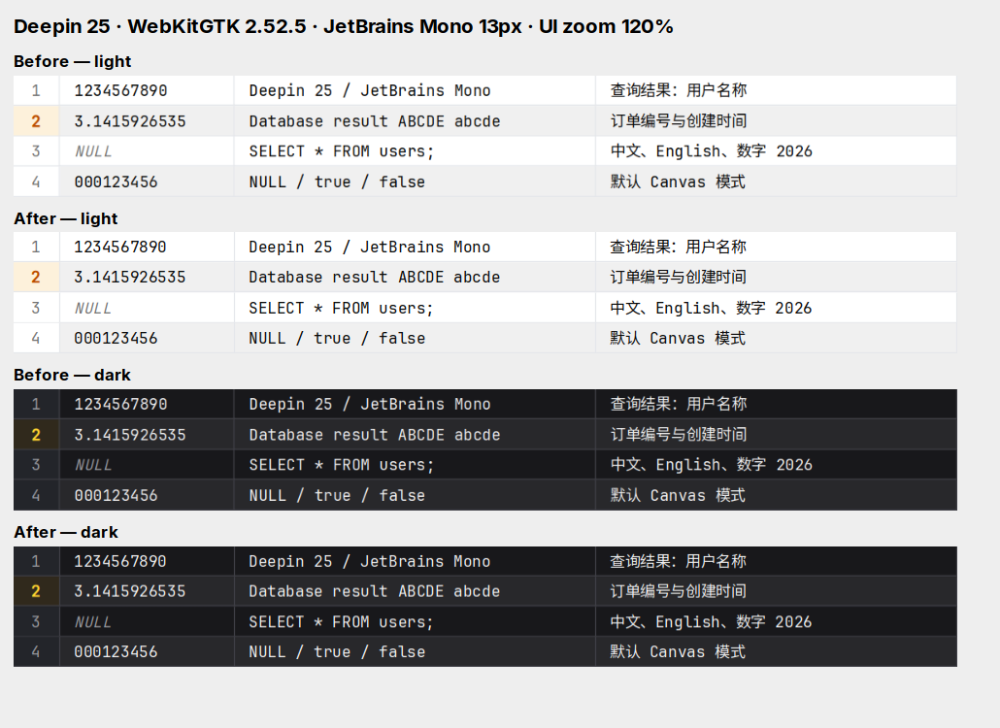

# Deepin Canvas grid text rendering

[Issue #11821](https://github.com/t8y2/dbx/issues/11821) reports blurry query-result text in the default Canvas renderer on Deepin 25. The reporter's settings use JetBrains Mono and 120% UI zoom.

This screenshot compares the production `drawCanvasDataGrid` renderer before and after the fix in a small test page, using the system WebKitGTK 2.52.5 engine on Deepin 25. It is a renderer comparison, not a screenshot of the full DBX desktop application. The page uses JetBrains Mono Regular at 13px, four 26px rows, Latin text, Chinese text, numbers, italic NULL values, and an edited row with a semibold row number. WebKit's native page zoom is set to 1.2, matching DBX's `setZoom(1.2)` path.

The engine reports `devicePixelRatio = 1.2000000476837158` and does not expose `ResizeObserverEntry.devicePixelContentBoxSize`. For the same 810 × 104 CSS-pixel surface:

| Renderer | Bitmap size | Text baseline |
| --- | --- | --- |
| Before | 1167 × 150 | Snapped middle anchor; glyph baseline remains fractional |
| After | 972 × 125 | Snapped alphabetic baseline |

The original fallback multiplies the zoom-inclusive DPR by the UI scale again, drawing at approximately 144% before WebKit downsamples to 120%. The fix uses Linux's reported DPR directly and rounds fallback dimensions to the nearest physical pixel, avoiding an extra pixel caused by floating-point zoom error. Exact observed physical sizes still take precedence when available.

Baseline conversion is measured and cached for each font variant, preserving the existing vertical centering within half a device pixel. Engines without actual glyph metrics retain middle alignment. Font readiness invalidates baseline and text-width caches and schedules a repaint, so the Canvas does not keep measurements from a temporary fallback font.

For a full desktop check, select Canvas rendering, JetBrains Mono, and 120% UI zoom in DBX on Deepin 25. Run a query with numbers, Chinese text, and NULL values; check light/dark themes, scrolling, edited row numbers, and other zoom settings. This full desktop interaction check was not performed for the captured comparison.
