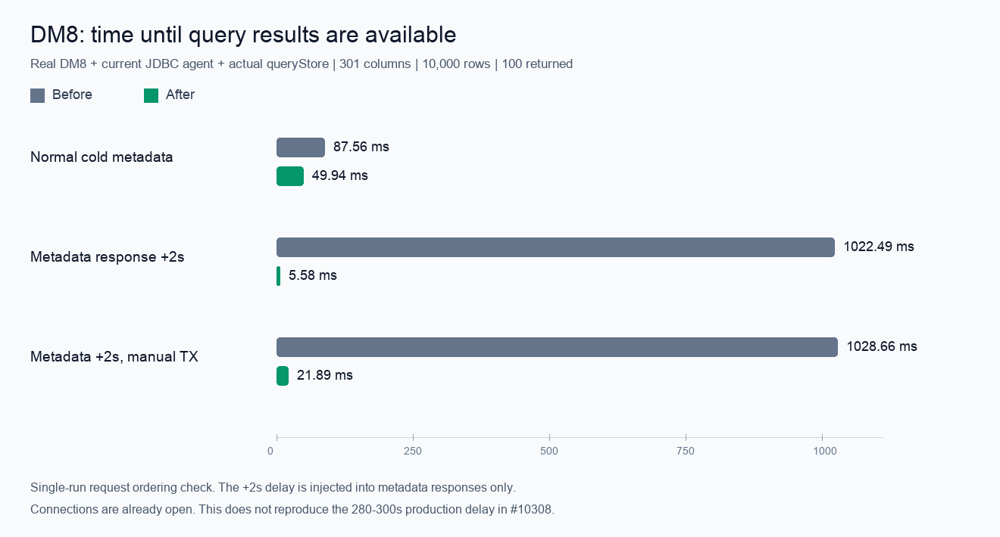

# 达梦查询元数据异步化实测（2026-10-14）

## 环境和边界

- 本地 `dm8_demo` 容器，DM Database Server 64 V8，构建标识 `03134284094-20230927-203585-20067`。
- 本次工作区源码构建的 Dameng JDBC agent，JDK 21，DmJdbcDriver8 8.1.5.45。
- 复用只读测试表 `SYSDBA.T10308W`：301 列、10,000 行，返回前 100 行。
- 运行实际 `useQueryStore().executeTabSql()`；临时 Vitest 驱动只把后端 API 映射到真实 agent JSON-RPC，SQL、列和索引均由真实达梦返回。SQL 分析使用现有前端分析器。
- 未启动 Web/Tauri 客户端或 Rust HTTP 网关，数字不包含真实 HTTP 传输和界面渲染。连接已打开；“冷”指表元数据缓存为空。
- 对照使用主线 `184b55c89`；优化使用同一主线上的改动。每个场景为一次时序校验，不能作为普遍性能增幅的统计结论。

## SQL

```sql
SELECT C1, C2, C3, C4
FROM SYSDBA.T10308W
FETCH FIRST 100 ROWS ONLY
```

## 结果

| 场景 | 改动前：结果可用 | 改动后：结果可用 |
| --- | ---: | ---: |
| Normal cold metadata | 87.56 ms | 49.94 ms |
| Metadata response +2s | 1022.49 ms | 5.58 ms |
| Metadata +2s, manual TX | 1028.66 ms | 21.89 ms |

额外 2 秒是测试驱动在真实 `get_columns` 响应之后注入的延迟，不是达梦实测的自然元数据耗时。对照路径会先发列/索引请求，等待约 1 秒的预检预算；优化后先发 SQL，结果返回后才发元数据请求。



## 校验内容

- 正常、慢元数据、手动事务三个场景均返回真实 100 行，列数据一致。
- 优化后每个冷缓存场景均满足 `execute:done` 早于 `columns:start` 和 `indexes:start`。
- 元数据未准备好时结果已可读，不对缺少主键的结果开启编辑。
- 元数据准备好后再次查询命中缓存，SQL 补入 `"ID" AS "__DBX_PK_0"`，隐藏列索引为 4，恢复编辑，未重复读取列元数据。
- 手动事务通过真实 agent 的 `begin_manual_transaction` 开始，读完后回滚。
- 修改前后各 3 个实测场景通过。另有元数据失败、过期响应、JDBC profile 和手动事务的常规回归测试。

完整时间戳及 SQL 记录见 [live-results.json](../assets/pr-dameng-query-metadata/live-results.json)。

此结果证明移除了达梦冷元数据对 SQL 派发的依赖，**未复现也未宣称解决 #10308 中 280–300 秒的完整生产延迟**。旧游标关闭、驱动及服务端查询耗时仍是独立排查方向。
