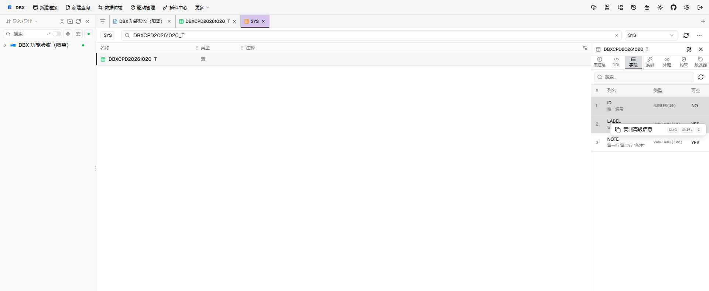

# 复制表字段信息

在对象浏览器中选择表，在右侧详情面板打开“字段”页签。单击选择字段；按住 Ctrl/⌘ 多选，按住 Shift 选择连续范围。

- `Ctrl+C`：按显示顺序复制所选字段名，每行一个。
- `Ctrl+Shift+C`：复制完整字段信息为 TSV，包含 `#`、列名、类型、可空、默认值和注释；注释独立为一列，含 Tab、换行或双引号的单元格会按 TSV 规则转义。
- 右键所选字段并选择“复制高级信息”：执行与 `Ctrl+Shift+C` 相同的复制。

