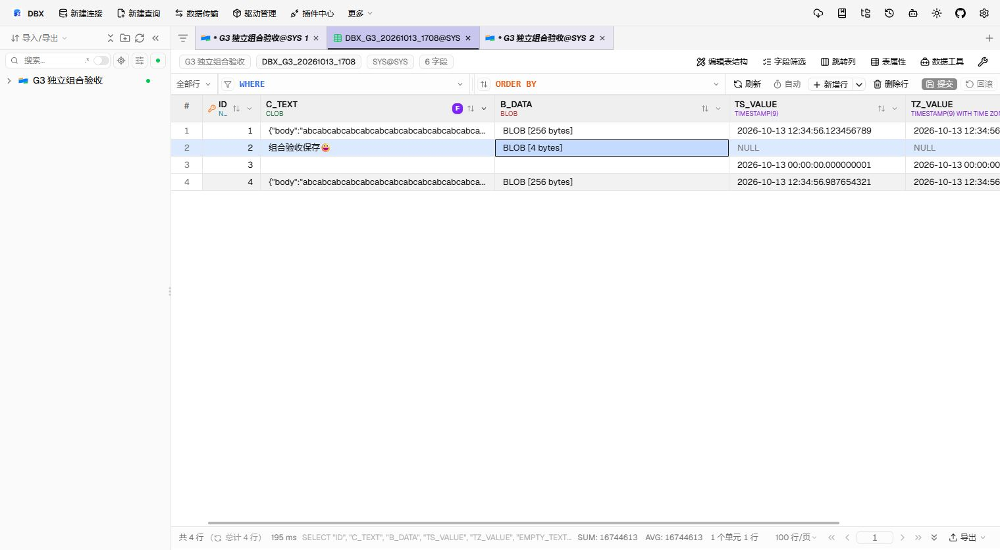

# OceanBase Oracle LOB regression acceptance

This batch covers result-snapshot CLOB/BLOB reading, writing, copying and exporting. Combination acceptance uses OceanBase Oracle 4.2.5.7 and Connector/J 2.4.19; the earlier locator acceptance used Connector/J 2.4.18. Automated tests with JDBC and transport fixtures do not establish support on other database versions.

## Reproduction and expected behavior

Use an authorized isolated table with a primary key, CLOB, BLOB and nullable temporal columns. Include SQL NULL, empty LOBs, Unicode text longer than the grid preview and binary data containing all byte values. Keep fixture credentials and connection details outside the PR.

1. Query the fixture, then update or delete its rows through a second connection. Read, copy and export the original result. The full value must come from its original retained locator and session; it must not use the preview or re-query the changed row. Expired references must report an error instead of opening another session.
2. Export selected cells and rows to CSV, JSON and XLSX. Compare complete values with the original fixture, including NULL versus empty text and empty binary data. Preserve selection, column order, header comments and existing spreadsheet formula protection. An incomplete snapshot must fail the operation instead of producing a successful truncated file.
3. Edit CLOB/BLOB cells and save. Read back exact content. Test empty values, NULL, multibyte text and binary values larger than one bind chunk. Concurrent changes must fail the old-value guard and retain the draft. Failed multi-statement writes must roll back; manual transactions must retain their existing ownership.
4. Start an asynchronous full-value copy, then change the focused cell. The original cell and column remain the copy target. Start another read, replace the result or dispose the grid while the backend remains pending, and reject the cancellation request. Local waiting must settle, late chunks must not modify either result, and a late HTTP preparation response must not start a download.
5. Close the result tab or disconnect one connection while a query is pending. Its result and client sessions must be released; other connections must remain usable. A late result must not restore the closed tab or its runtime state.
6. Hold the original session's registry, transaction or Agent lock, then cancel a LOB request. Core must finish local waiting and remove its task registration. Missing original pools, wrong client sessions and metadata-only pools must not create replacement locator sessions.
7. Render and export NULL date/time cells and explicit timezone values. NULL stays NULL; SQL extraction preserves the explicit timezone information.
8. Apply a JSON-path formatter whose value appears after the CLOB preview. Export the current page, selected cells and all loaded rows to CSV/JSON/XLSX with formatters enabled and disabled. Formatting must receive the full selected value; unformatted BLOBs must still stream from their original references. Keep NULL and empty LOBs distinct. An XLSX cell exceeding 32,767 characters must fail explicitly instead of truncating.
9. Export source-dialect SQL with formatting enabled in the grid, then replay the downloaded file into a separate isolated table. Compare complete CLOB/BLOB content, NULL versus empty LOBs, nine fractional timestamp digits and explicit offsets, including the driver's space-separated `+8:00` and `-5:30` forms. Include a BLOB larger than 2,000 bytes and a CLOB containing Unicode and quotes beyond one SQL literal chunk. SQL export must use original values rather than display formatting.

## Automated coverage

- Frontend tests call the real editor, exporter, large-value composable, snapshot helpers and query/connection stores, with external backend calls controlled by fixtures.
- Agent tests cover chunk boundaries, retained locator lifetime, resource limits, typed BLOB bindings and RPC dispatch. Opt-in database tests must be reported as skipped when their environment is absent.
- Core tests cover snapshot export, original-session lookup and cancellation while waiting for locks. Transport tests cover late browser-download responses.
- SQL export tests use the production builders and script splitter. They cover Oracle-compatible temporal aliases, OceanBase LOB constructors and large-BLOB blocks, malformed hex, excluded columns, ordinary text and Standard-dialect compatibility. Large-BLOB blocks reuse the grid's existing temporary-LOB cleanup; they do not add grid-save row guards or transaction handling to export.
- Tests, type checking, compilation, database acceptance and GUI acceptance are separate evidence layers. Record the exact candidate and results in the PR.

## Limits and remaining acceptance

Local cancellation settles client waiting. It does not prove database-side statement termination or physical server cursor release. Native delivery may already have persisted its destination before cancellation reaches the caller; browser late-response checks do not establish atomic native-file cancellation.

Formatting a LOB requires materializing its full value within the existing 16 MiB per-value and 64 MiB combined limits. Unformatted snapshot cells retain the streaming path. The OceanBase BLOB SQL constructors and block wrapper do not establish native Oracle BLOB support. Native Oracle database acceptance for the 2026-10-13 combination batch was explicitly deferred; retain that gap separately from OceanBase results.

The 2026-10-13 combination candidate was tested on upstream base `a86520234e6f5b25bd9de6f9adbff6bf73e46140` with its own Web build and Agent JAR. GUI-downloaded source SQL replayed through the production script endpoint preserved four rows, including a 36,028-character CLOB, a 4,000-byte BLOB, NULL/empty LOBs, nine fractional timestamp digits and positive/negative offsets. GUI CLOB/BLOB edits were read back independently; both isolated fixture tables were removed and absence was verified. The two opt-in snapshot integration tests passed without skips. Clipboard, CSV/JSON and formatted XLSX content were checked; oversized unformatted XLSX failed explicitly. Cancellation and late-result races have automated coverage, not a claim of database-side termination or native-file atomicity.

