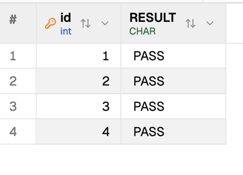

# PostgreSQL to Xugu table transfer

## Scope and isolation

The adapter is selected only for native `postgres -> xugu`. It does not enable
Kingbase, openGauss, other PostgreSQL-compatible products, reverse transfers, or
schema-object conversion. Existing database pairs keep their previous paths.

Append and overwrite use the existing transfer task, cancellation, SQL batching,
read-only connection protection, and progress reporting. Column names must be
preserved; structure transfer also preserves the table's spelling. Filters,
upsert, and destructive drop/recreate are outside this first phase.
The filter editor is hidden for this pair, but filters loaded from a preset are
not silently discarded: the backend rejects them before any target change.

## Mapping contract

| PostgreSQL                          | Xugu                                      | Contract                                                                  |
| ----------------------------------- | ----------------------------------------- | ------------------------------------------------------------------------- |
| smallint / integer / bigint         | SMALLINT / INTEGER / BIGINT               | Exact integral values; projected as text                                  |
| oid                                 | BIGINT                                    | Numeric OID values, not referenced large-object contents                  |
| numeric(p,s)                        | NUMERIC(p,s)                              | p <= 38 and 0 <= s <= p; no unconstrained inference                       |
| real / double precision             | FLOAT / DOUBLE                            | Finite values only                                                        |
| boolean                             | BOOLEAN                                   | SQL NULL remains distinct from false                                      |
| character(n) / character varying(n) | CHAR(n) / VARCHAR(n)                      | At most 60,000 characters; VARCHAR trailing spaces rejected               |
| text / unlimited character varying  | CLOB                                      | No silent VARCHAR truncation                                              |
| bytea                               | BLOB                                      | Hexadecimal wire projection, including empty and embedded zero bytes      |
| uuid                                | VARCHAR(36)                               | Canonical UUID text; no dependence on GUID decoding                       |
| json / jsonb                        | CLOB                                      | Preserve document text and large numeric tokens; not a native JSON column |
| date                                | DATE                                      | Finite AD dates, years 1 through 9999                                     |
| time(p) without time zone           | TIME(p), or INTERVAL HOUR(2) TO SECOND(6) | p <= 3 uses TIME; default/p > 3 uses the microsecond interval mapping     |
| timestamp(p) without time zone      | DATETIME(p)                               | p <= 6; finite AD dates, years 1 through 9999                             |
| timestamp(p) with time zone         | DATETIME(p) WITH TIME ZONE                | UTC instant, p <= 6; source session timezone and DST do not change it     |
| time(p) with time zone              | TIME(p) WITH TIME ZONE                    | Explicit p <= 3; minute-aligned offsets -12:59 through +14:59; not 24:00  |
| bit(n) / bit varying(n)             | BIT(n) / VARBIT(n)                        | Up to 60,000 bits; exact fixed width, leading zeros and empty VARBIT      |
| unbounded bit varying               | VARBIT(60000)                             | Longer actual values fail before overwrite; no truncation                 |
| xml / jsonpath                      | CLOB                                      | Preserve textual contents; XML fragments need not be complete documents   |
| name                                | VARCHAR(64)                               | Text restrictions below still apply                                       |
| xid                                 | BIGINT                                    | Unsigned 32-bit numeric identifier, not transaction-history semantics     |
| qualified year/month intervals      | INTERVAL YEAR(8) TO MONTH                 | Absolute months <= 1,199,999,999; no day/time components                  |
| qualified day/time intervals        | INTERVAL DAY(6) TO SECOND(6)              | Absolute days <= 999,999; same-sign day/time components; hours < 24       |

Unqualified NUMERIC and INTERVAL, microsecond TIMETZ, arrays, ranges, multiranges,
enums, domains, network types, money, xid8, full-text types, pg_lsn, native geometric
types, PostGIS and vectors currently fail explicitly. There is no generic "copy
the source type spelling" fallback. NUMERIC is not narrowed by inspecting the
first rows, MONEY is not parsed with an assumed locale/scale, and an arbitrary
INTERVAL is not stripped of its independent month/day/microsecond components.

High-precision TIME maps to an interval, not a native time-of-day column. Its
00:00 through 24:00 values and microseconds are retained, but target type/operations
are different. XML and JSONPATH use text storage, not their PostgreSQL query
operators. These are explicit mapping contracts, not native type parity claims.

The current native Xugu text path cannot preserve supplementary Unicode or NUL
text. Those values are rejected before overwrite. BYTEA is binary and is not
subject to the text restriction.

The native Xugu JSON representation did not preserve a 30-digit integer during
live round-trip testing. Therefore this phase deliberately stores PostgreSQL
JSON/JSONB as CLOB, rather than silently rounding values. An existing native
JSON target is rejected; this is not advertised as native JSON type parity.
Keys requiring an index over a mapped CLOB/BLOB are also rejected explicitly.

## Structure safety

An exact `pg_catalog` query supplies table identity, column order, defaults,
identity-sequence parameters, keys, comments and unsupported-feature evidence.
Incomplete or mismatched evidence is fatal. The first phase accepts ordinary
persistent PostgreSQL 12+ tables with primary/unique keys, nullability, comments,
literal defaults, INTEGER/BIGINT serial and BY DEFAULT identity columns with supported bounds.

Partitioning, inheritance, row-security policies, custom collations, generated
expressions, ALWAYS identities, cycling/custom-bound sequences, user triggers/rewrite rules,
standalone indexes, foreign/check/exclusion/deferrable constraints and
NULLS NOT DISTINCT keys and non-plain key indexes (INCLUDE, custom operator
classes/collations/order, invalid or unready indexes) are rejected rather than silently omitted. Arbitrary
default expressions and unowned sequence references are not translated. A sequence
owned by a column is accepted as serial only when its plain NEXTVAL default refers
to that same sequence. Non-NULL BYTEA defaults are rejected rather than converted
into text bytes incorrectly.

All selected tables are preflighted before the runner's overwrite pass, and the
public per-table entry point repeats the checks. Existing target columns must
have compatible types, capacity and nullability. Required extra columns are
rejected. Identity synchronization uses the existing Xugu sequence handling,
including negative increments and already-advanced sequences.

## Read and write safety

Native PostgreSQL keyset/heap pagination runs before lossless text projection.
Outer ordering refers to native subquery columns, not text aliases; otherwise
`10` could sort before `2` and make keyset pagination skip rows. The heap cursor
column is preserved until the existing pager consumes it. Temporal formatting
must not depend on the source connection's DateStyle.

As with the existing paged transfer paths, the source should remain quiescent
during transfer; this adapter does not claim a cross-table consistent snapshot.
Writes are not replayed after an ambiguous timeout. Previously acknowledged
Xugu batches are not rolled back by cancellation, and progress must report them.

## Verification checklist

Do not mark this implementation ready for a PR until the applicable rows have
recorded results. Rejected unsupported cases count as passing safety tests only
when the target's sentinel data demonstrably remains unchanged.

- [x] Unit mapping, catalog completeness, identifiers, comments and defaults.
- [x] Frontend direction restrictions and existing transfer regressions.
- [x] Backend transfer regressions and external-consumer compilation.
- [x] Native PostgreSQL to native Xugu, through the public transfer API.
- [x] Empty source; SQL NULL; empty strings; quotes, backslashes and Chinese text.
- [x] Integer extremes, 38-digit decimals, fractional and extreme finite floats.
- [x] DATE/TIME/DATETIME precision and non-ISO DateStyle.
- [x] 160KB CLOB (all chunks) and 140KB BLOB (all bytes), not just lengths/counts.
- [x] JSON/JSONB null/scalars/objects/arrays, escapes and large numeric tokens.
- [x] UUIDs and OIDs; documented representations verified.
- [x] BY DEFAULT identity, custom positive/negative steps and advanced target sequence.
- [x] Serial identity in the packaged UI: transferred BIGSERIAL IDs 1–4,
      then an omitted-ID INSERT generated ID 5.
- [x] Composite primary keys and duplicate append failures.
- [x] Live nullable composite unique keys, multiple NULL entries and duplicate non-NULL rejection.
- [x] Append, overwrite, structure-only, data-only and empty-source overwrite.
- [x] Six live incompatible-target capacity/nullability cases preserve target sentinels.
- [x] 12,007-row keyset and keyless transfers, count/sum/distinct verification.
- [x] Ordinary PostgreSQL source: no elevated role attributes; missing SELECT
      blocks overwrite, fixture-only SELECT permits transfer, revocation blocks
      it again, and INSERT is denied. Temporary login and fixtures were removed.
- [x] Existing non-SYSDBA Xugu target in its business database: four mixed rows
      copied and verified through the packaged UI. Its one custom role had no
      parent roles; no DB_ADMIN role was returned by the read-only catalog check.
- [x] SELECT-only Xugu target: UI SELECT returned four rows and UI INSERT failed
      with permission error E18012. Public transfer API append/overwrite and direct
      INSERT/TRUNCATE were rejected; target counts/sums stayed unchanged. The UI
      schema picker did not expose the unowned schema; no schema-wide grant was added.
- [x] Running cancellation: acknowledged counts equal target counts.
- [x] Source lock timeout: target sentinel preserved; later transfer recovers.
- [x] Packaged target lock timeout and lost TRUNCATE acknowledgment; separate
      real public-API lost INSERT acknowledgment. Fault relay counters proved one
      forwarded write each, not automatic replay. See recorded caveats below.
- [x] Thirteen unsupported type/feature cases preserve a preexisting target sentinel.
- [x] Sixteen additional feature rejections: standalone/referenced unique indexes,
      rewrite rules, row security, unlogged tables, generated expressions,
      deferrable/INCLUDE keys, custom collation/default expressions, foreign keys,
      partition roots, inheritance, user triggers, non-NULL BYTEA defaults and
      owned-but-nonserial sequences. All target sentinels survived.
- [x] Packaged DEV 0.6.61: exact bundle/process path verified; native PG connection
      added without saving its password. Table-only selection hid the fixture view.
      Three-table structure/data transfer completed with zero failed tables.
- [x] Existing PostgreSQL->PostgreSQL identity/upsert live control.
- [x] Packaged UI controls: existing MySQL->Xugu copied five synthetic rows;
      Xugu->Xugu copied four mixed rows whose values were verified again.
- [x] Extended live values: default/microsecond TIME and 24:00, UTC timestamptz
      across a DST jump, minute-offset TIMETZ, 60,000-bit VARBIT, exact leading
      zeros, empty/NULL bits, XML fragments/declarations/escapes, NAME, JSONPATH, XID.
- [x] Every qualified year/month or day/time interval spelling, including
      positive/negative and maximum-range values; non-default IntervalStyle.
- [x] Eleven otherwise-supported domains reject unsafe values before overwrite,
      including offset seconds/out-of-range offsets, infinite/BC UTC timestamps,
      mixed-sign/overflow intervals, 60,001-bit values and trailing NAME spaces.
- [x] Twenty-four individually created unsupported declarations preserve sentinel
      data. Not every unsupported PostgreSQL extension/type is available in PG 12.
- [x] Eight additional live target-capacity/type rejections preserve sentinel
      data: zoned temporal precision, high-precision TIME, fixed/variable bits,
      year/month and day/time interval range, and native XML versus text storage.
- [x] Rebuilt DEV UI verification of the extended mapping: 4 copied rows, zero
      failed tables, all four target CASE checks PASS. An overwrite selection
      containing unqualified INTERVAL was refused during preparation; all four
      existing target CASE checks remained PASS.

Use only disposable synthetic fixtures. Connection configuration and credentials
stay outside this document and outside the repository.

## Recorded results (2026-10-29 through 2026-10-30)

- Base: upstream main `1b8dfd967`; separate PostgreSQL-to-Xugu branch.
- 586 backend transfer tests passed, including 14 new adapter tests.
- 421 frontend transfer tests passed; full frontend type check passed.
- PostgreSQL 12.16 live source; native Xugu target, not XuguDB Agentic.
- The opt-in public-API integration test passed. It covers the checked live
  cases above, including exact SMALLINT bounds, all 38 integral decimal digits,
  four Chinese characters in CHAR(4)/VARCHAR(4), unlimited VARCHAR trailing
  spaces via CLOB, float subnormals/maxima and distinct empty/NULL LOBs.
- The native JSON control returned `1.234567890123457e+29` for the source token
  `123456789012345678901234567890`. The CLOB mapping retained the complete token.
- Xugu's session-default DATETIME-to-VARCHAR rendering omitted fractional
  seconds. Verification instead uses the explicitly tested
  `TO_CHAR(value,'YYYY-MM-DD HH24:MI:SS.SSSSSS')` mask; stored microseconds passed.
- Clippy completed; warnings were in existing unrelated code. The new adapter
  had no reported Clippy warnings. This is not a claim that remote CI has run.
- After the initial keychain/locked-desktop blocker was resolved, the final
  0.6.61 DEV bundle was regenerated with the preset-filter, catalog, serial and
  default-safety guards. Its version and exact running process path were verified.
- With operator approval, the ordinary-source permission live test passed:
  missing SELECT, granted SELECT, revoked SELECT and denied INSERT. Target
  sentinel/data checks passed throughout. The temporary login was deleted and
  its absence verified; existing accounts were not changed. Ordinary Xugu target
  validation and cleanup subsequently passed as recorded below.
- No PR has been created for this adapter.

### Packaged UI results (2026-10-30)

- The mixed table had four rows, the large table 12,007 and the empty table zero.
  The large table ID sum was 72,090,028. Mixed-row CASE checks all returned PASS
  for exact decimals, microseconds, JSON large integers, NULL/empty values and
  176KB text / 140KB binary values.
- Duplicate append failed with the expected unique-constraint error and zero
  copied rows. A subsequent array-table plus mixed-table overwrite request was
  rejected during preparation. The mixed target retained five rows, maximum ID
  five, and its one generated sentinel row. A valid mixed-only overwrite copied
  four source rows successfully.
- A running single-row-batch transfer was cancelled. The UI reported 178 copied
  rows; the target count was exactly 178, maximum ID 178 and ID sum 15,931.
  This confirms acknowledged partial writes, not transactional rollback.
- Data-only overwrite then restored 12,007 rows, maximum ID 12,007 and the
  original ID sum 72,090,028. Structure-only transfer created the empty fixture
  in a different target schema and reported zero copied rows, zero failed tables.
- An existing non-SYSDBA target connection copied and verified all four mixed
  rows in its business database without changing any account grants. The
  SELECT-only negative case used a separately approved temporary target account,
  rather than altering an existing account. SELECT succeeded, INSERT and
  TRUNCATE were denied, append/overwrite API calls failed without changing the
  target, and the account and temporary DEV connection were removed. A SYSTEM
  catalog check confirmed zero remaining accounts with that temporary name.
- Target lock failure: a transaction held an exclusive lock on the fixture only.
  With a two-second operation timeout, the packaged task failed in approximately
  2.5 seconds with E14012. After rollback, the target still had four rows and ID
  sum 10. A new manually started transfer succeeded.
- Lost TRUNCATE response: a loopback-only relay forwarded the fixture's TRUNCATE
  once, then suppressed its response. The packaged task reported failure after
  approximately 7.9 seconds (including session retirement). The server had
  cleared the fixture even though the client did not receive acknowledgment.
  No INSERT followed and no TRUNCATE replay occurred. The relay and its DEV
  connection were removed; a direct, manually started transfer restored all four
  rows, with every mixed-row UI CASE check returning PASS again.
- Lost INSERT response: the public-API integration test seeded an extra target
  sentinel, then performed overwrite through a relay that suppressed only the
  INSERT response. The call failed, but the direct administrator check found
  four committed source rows, ID sum 10, and no old sentinel. The relay recorded
  exactly one INSERT. Thus failure/zero acknowledged rows is not a rollback claim.
  The relay was shut down after verification.

### Explicit operational caveats

Overwrite is not atomic across TRUNCATE and INSERT. After a write timeout or a
lost response, inspect the target before deciding how to recover; the operation
may already have applied. No automatic replay is safer than assuming rollback.
The two-second setting is an operation deadline, not a promise that connection
retirement and task reporting will also finish within two seconds.

With only an object-level SELECT grant, this tested Xugu installation exposed
only the user's own schema through ALL_SCHEMAS. Direct qualified SELECT worked,
but the transfer UI could not select the unowned schema. This is recorded as a
metadata-visibility limitation, not as a successful UI transfer into that schema.

### Extended mapping verification (2026-10-30)

The dedicated extended integration test passed with 13 qualified interval
spellings, 24 individually rejected declarations, 11 unsafe-value cases and
eight incompatible-existing-target cases. The original live suite passed again
after these mapping changes (including its 12,007-row pagination/identity/LOB
checks). The 587 backend transfer tests passed with `RUST_MIN_STACK=8388608`, the
same setting used by this repository's CI. A preliminary run without that CI
setting aborted in the existing rebuild-preview test with a stack overflow;
no product-code workaround or test exclusion was added.

The rebuilt/signed 0.6.61 DEV copied the four-row extended fixture in two-row
batches in 786ms, with zero failed tables. Four target CASE checks all returned
PASS. An overwrite selection containing both this table and an unqualified
INTERVAL table was refused during preparation; all four target checks remained
PASS. The existing non-SYSDBA business-database target connection independently
copied the same four rows in 673ms with zero failed tables and all four CASE checks
PASS. No account permissions were changed for this additional UI run.

The extended UI fixture is
[`fixtures/postgres-xugu-extended-ui.sql`](fixtures/postgres-xugu-extended-ui.sql).
The full reference-type reconciliation, including explicit unsupported and
not-live-tested entries, is [the type coverage matrix](postgres-xugu-type-coverage.md).
This does not fix the separately deferred native Go-driver BIT grid-display
issue; bit data was checked through explicit server-side text projection.

The screenshot below is an actual packaged DEV query result, cropped to remove
all connection, account and endpoint information. It shows all four extended
fixture rows passing value checks through the ordinary target connection.



### Submission base

The implementation was rebased without conflicts onto upstream main `493ddf946`
after its packaged UI verification. The pair-specific production files had no
intervening upstream changes. Submission-time unit and public-API live checks
were rerun against that base. The earlier packaged verification is not claimed
to be a newly generated package of that later base.

### Opt-in live test

Provide disposable JSON connection configurations in
`DBX_LIVE_PG_XUGU_SOURCE_CONFIG` and `DBX_LIVE_PG_XUGU_TARGET_CONFIG`, an existing
test schema in `DBX_LIVE_PG_XUGU_TARGET_SCHEMA`, and the installed Xugu agent
directory in `DBX_LIVE_PG_XUGU_AGENT_DIR`. Then run:

```sh
cargo test -p dbx-core --no-default-features --features sqlite-bundled \
  --test live_postgres_xugu_transfer \
  live_postgres_xugu_types_pages_and_overwrite_protection -- --ignored --nocapture
```

Normal CI compiles but does not execute this ignored test. Do not commit the
environment values or a credential-bearing command transcript.

The separate `live_postgres_xugu_source_permissions` test creates and removes a
temporary login, with USAGE and SELECT grants restricted to its new fixture.
Run it only with explicit operator approval and
`DBX_LIVE_PG_XUGU_ALLOW_TEMP_LOGIN=1`. It does not change existing accounts or
the database's preexisting PUBLIC grants.

The packaged tests used the credential-free synthetic setup in
[`fixtures/postgres-xugu-ui.sql`](fixtures/postgres-xugu-ui.sql). The separate
`live_postgres_xugu_readonly_target` test requires an already approved temporary
reader configuration and fixture/schema environment variables. The
`live_postgres_xugu_lost_insert_reply` test requires explicit
`DBX_LIVE_PG_XUGU_ALLOW_FAULT=1` and an armed loopback relay supplied through
`DBX_LIVE_PG_XUGU_PROXY_CONFIG`; independently verify its one-write counter.
Neither test should be run against business data.
