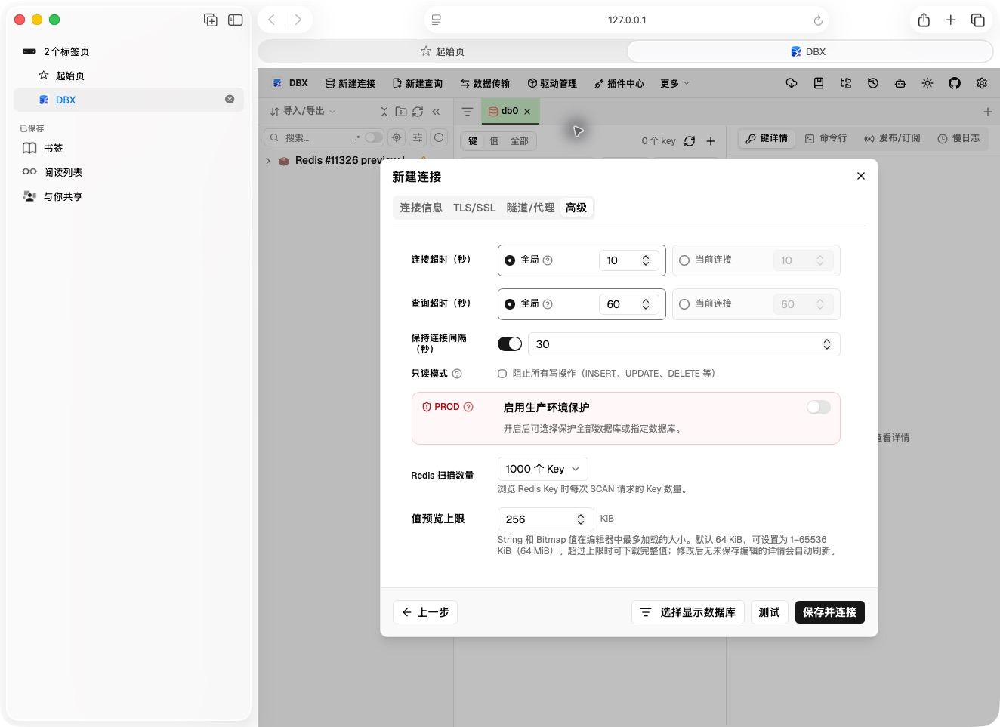
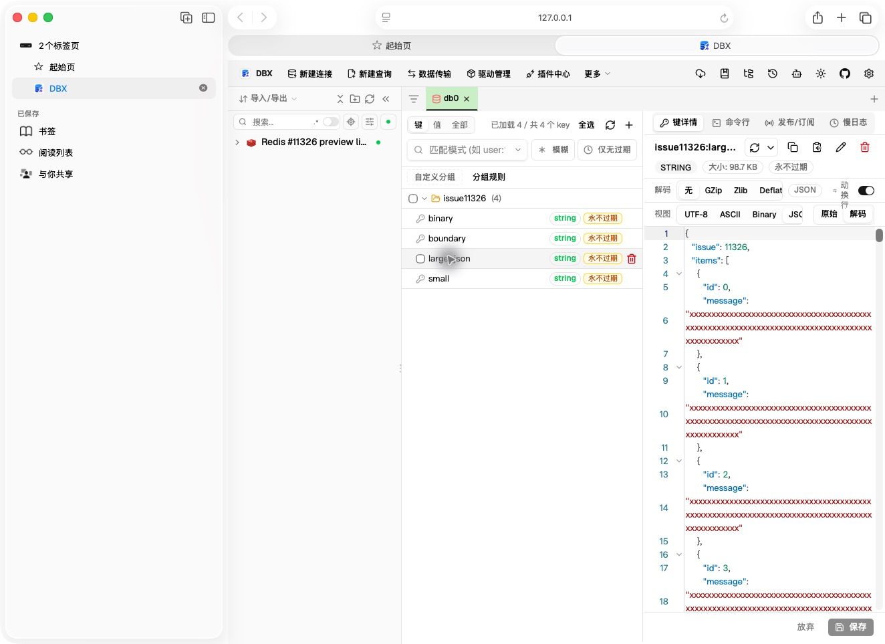

# Configurable Redis value preview limit (#11326)

Verified on macOS 26.3 with the local DBX Web build on 2026-10-14.

The new setting is at the bottom of **Redis connection → Advanced settings**. It is stored globally and applies to every Redis connection. It defaults to 64 KiB and
accepts 1–65536 KiB. The selected value is passed to the Redis String/Bitmap
preview request; complete downloads still use the raw-value endpoint.

## Manual Web verification

A local Redis 7.4.9 server was seeded with these values:

- a 101,084 byte JSON document containing 850 items and a final `END-11326` marker;
- a 131,072 byte binary value containing every byte from 0 through 255 repeatedly;
- a 5 byte value;
- a 65,536 byte boundary value.

With the default 64 KiB setting, the 101,084 byte JSON appeared as a read-only
preview with the message that only 64 KiB was loaded. After changing the setting
to 256 KiB and applying it, the open detail automatically refreshed: the full
JSON became editable, the truncation notice disappeared, and the final items
and `END-11326` marker were visible. Reloading the Web app preserved 256 KiB and
opening the same key again kept the full editable value.

## Automated verification

- 187 `dbx-driver-redis` unit tests passed.
- The ignored integration test against the local Redis server passed for text,
  UTF-8 Chinese content, and binary data: 64 KiB truncation, 256 KiB complete
  reads, exact-boundary reads, and complete raw downloads all preserved bytes.
- 470 frontend tests passed across 23 focused suites, including Redis viewer behavior, settings apply and reset, settings transfer validation, and HTTP/Tauri argument forwarding.
- Frontend formatting, lint, typecheck, and the Web backend build passed.
- Invalid preview sizes below 1 KiB and above 64 MiB were rejected before Redis
  I/O.
