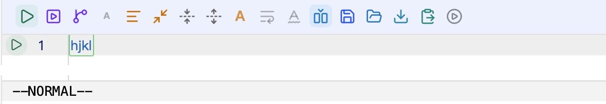
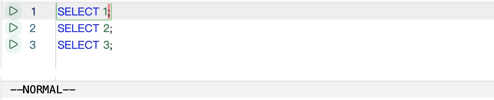

# Vim normal mode IME regression (#8883)

Verified on macOS 26.3 on 2026-10-13.

## Reproduction and desktop checks

The installed DBX 0.6.41 reproduced the report: starting with an empty editor,
pressing Escape, h/j/k/l, Enter and Escape left `hjkl` in SQL while the status
still displayed NORMAL. The system input source was Pinyin – Simplified.



A local desktop build based on 0.6.42 used an isolated data directory and a
SQLite in-memory connection. The embedded frontend ran at `tauri://localhost`.
Normal-mode h/j/k/l left the three-line SQL document intact. INSERT-mode
multiline clipboard paste, Escape, gg, yy, p and u worked as expected.



On 2026-10-13, the user manually tested the final source in the **DBX Vim Source
Check** desktop app and confirmed that h/j/k/l in NORMAL move the cursor rather
than insert text. This manual check supplements the automated desktop input
below. The user did not specify the input method used in that check.

The control tool's printable keys in the new desktop process arrived as ordinary
English keydown events, without composition events. Those automated desktop
checks alone do not establish that real Pinyin candidate submission is fixed.
Baidu and Doubao input methods were not enabled on this machine; their behavior,
visual navigation and Chinese composition in INSERT have not been manually
verified in this run.

## Regression coverage

A mounted QueryEditor regression fails on the unpatched upstream component and
passes with the guard. Tests use the real CodeMirror Vim extension to cover
Process/Unidentified keys, keyCode 229, composition-active navigation, operators,
counts, visual editing, undo, normal-mode stray text, insert-mode Chinese text,
literal commands, shortcuts, paste and disabling/re-enabling Vim. DOM mutation
tests also check that rejected composition text is removed from the rendered
editor, while insert-mode Chinese composition changes reach the document.

```sh
pnpm exec vitest run apps/desktop/src/lib/editor/__tests__/vimImeGuard.spec.ts \
  apps/desktop/src/lib/editor/__tests__/vimConfig.spec.ts \
  apps/desktop/src/lib/editor/__tests__/vimSystemClipboard.spec.ts \
  apps/desktop/src/components/editor/__tests__/QueryEditor.componentSplit.integration.spec.ts \
  apps/desktop/src/components/editor/__tests__/QueryEditor.snippetEscape.integration.spec.ts \
  apps/desktop/src/components/editor/__tests__/useQueryEditorCompletionKeys.spec.ts
```

The six suites pass (88 tests). Frontend formatting, lint, typecheck (with the
CI 8 GiB Node heap setting), the Vite production build and the native desktop
build also pass. Lint and native builds report existing warnings outside the
changed code. No i18n keys were added.
