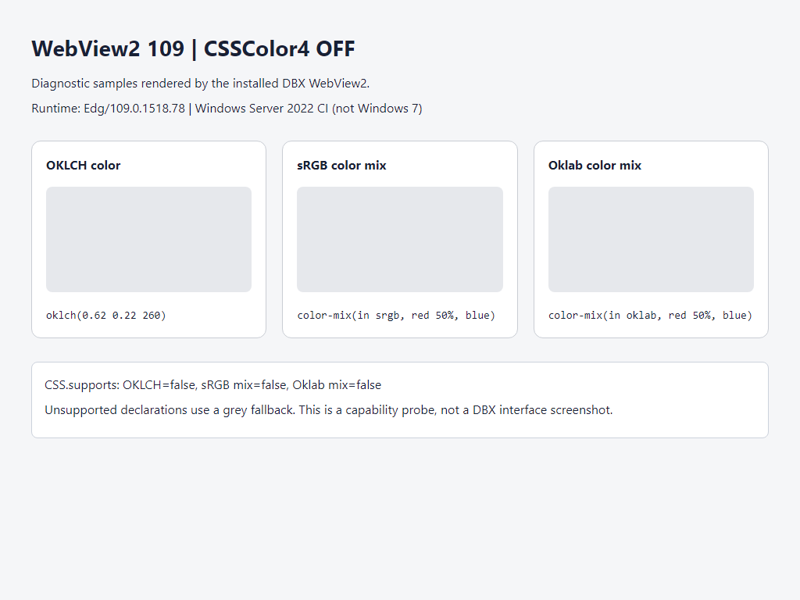
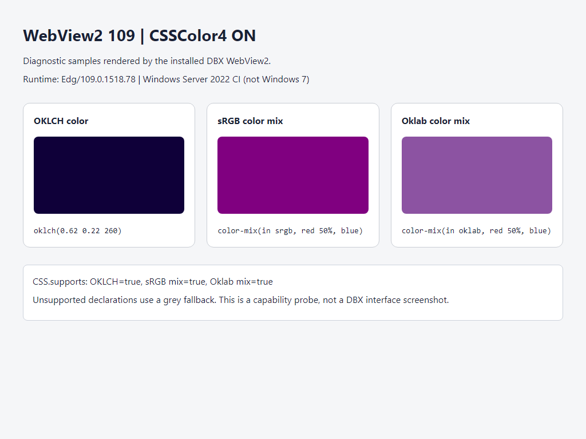

# Win7 WebView2 现代颜色兼容实验

Win7 安装包使用固定的 WebView2 109.0.1518.78。该版本内置的 `CSSColor4` 默认未开启，导致 `oklch()`、`color-mix()` 等颜色声明无法生效。

`x86_64-win7-windows-msvc` 构建在创建 WebView2 前，将 `CSSColor4` 合并到 `WEBVIEW2_ADDITIONAL_BROWSER_ARGUMENTS` 的最后一个 `--enable-blink-features` 参数中。保留已有参数与其他功能名称，并尊重显式的 `--disable-blink-features=CSSColor4`。其他目标不自动请求该功能。

这项改动只启用现有内核中的颜色实现，不更换运行时、加载器或业务样式。Chromium 109 将此能力标为实验特性，不能据此视为完整支持现代 CSS。

## 验证与回退

每次切换前完全退出 DBX，包括托盘进程，避免新启动被转交给已经运行的实例。

- 正常启动 Win7 构建：默认请求 CSSColor4。
- 设置 `DBX_DISABLE_WIN7_CSS_COLOR4=1`：明确关闭该功能，可用于对比或兼容回退。
- 设置 `DBX_KEEP_STARTUP_LOG=1`：保留 `%APPDATA%\com.dbx.app\startup.log`；其中 `CSSColor4 requested=true/false` 表示参数请求状态，仍应通过实际页面验证生效情况。

例如，在 PowerShell 中将程序路径替换为实际位置：

```powershell
$env:DBX_KEEP_STARTUP_LOG = '1'
$env:DBX_DISABLE_WIN7_CSS_COLOR4 = '1'
& 'C:\path\to\dbx.exe'
```

重新启用时，完全退出 DBX，移除 `DBX_DISABLE_WIN7_CSS_COLOR4` 或设为 `0`，然后再次启动。

建议比较亮/暗主题、背景、边框、悬停与选中状态，同时检查弹窗、DOM 与 Canvas 表格、滚动和输入法。

## 已知颜色兼容差异

可见诊断页发现：开启后，`oklch(0.62 0.22 260)` 虽然被接受，实际渲染却明显偏暗。109 的早期实验实现与当前颜色语法存在差异，`CSS.supports()` 返回 true 不足以确认主题色正确。

Win7 用户实机测试反馈整体展示比之前明显改善。色块偏暗作为已知兼容差异继续跟踪，保留 `DBX_DISABLE_WIN7_CSS_COLOR4=1` 以便按需回退。

下图均由测试包的 WebView2 109 渲染，运行环境为 Windows Server 2022 CI。它们是隔离颜色能力的诊断页，不是完整 DBX 界面，也不是 Win7 系统截图。

| 关闭 CSSColor4 | 开启 CSSColor4（OKLCH 色块偏暗） |
| --- | --- |
|  |  |

[可见渲染验证构建](https://github.com/zipg/dbx/actions/runs/39269676386)；原始结果见 [关闭](result-off.json) 与 [开启](result-on.json)。

## 已有验证

- 参数合并与回退策略有 8 个单元测试，覆盖目标限制、原有参数、引号、重复开关、幂等性、显式禁用与退出开关。
- 测试包已完成 Win7 目标编译、PE/加载器与安装内容审计。
- Windows CI 中，真实 DBX 与固定 WebView2 109 的开/关对比探针已通过：`oklch()`、sRGB 和 Oklab `color-mix()` 从不支持变为支持。该结果只验证声明可用性，不验证显示颜色是否正确。
- Win7 用户实机反馈：整体展示比之前明显改善，部分此前缺失的新样式能够展示；尚未覆盖全部界面与设备配置。

CI 使用 Windows Server 2022，截图与能力探针不能替代 Win7 系统兼容性测试。对应测试包构建：<https://github.com/zipg/dbx/actions/runs/39098197448>。
