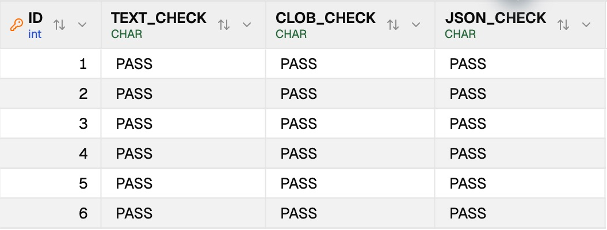

# Xugu transfer text-escaping regression

## Bug and scope

Native Xugu ordinary string literals retain backslashes. The generic transfer
encoder omitted Xugu from its literal-backslash dialect list, doubling each
backslash before INSERT. A task could finish successfully while its target CLOB
and JSON text no longer matched the source. For example, the 12-character text
`hello\world!` became 13 characters.

The production behavior change adds **only Xugu** to that existing dialect rule.
Single quotes are still escaped as `''`. Binary, BIT, interval, temporal and
spatial literal handlers retain their earlier precedence. No Go driver, Agent,
frontend, type mapping, capability or connection setting is changed. A comment
on the already-correct MySQL-to-Xugu adapter is updated to match this rule.

Table-file import shares this encoder and intentionally receives the same Xugu
correction. Other target dialects keep their earlier output. This does not repair
data already changed by an older transfer; recopy it from a verified source.

## Base and actual test artifact

- Base: upstream main `493ddf946`, fetched before this separate fix branch.
- Rebuilt and signed **DBX Xugu Escape Dev 0.6.61**; verified the running process
  belonged to that bundle, not the release app or an older DEV.
- Packaged binary SHA-256:
  `28f13d03dc044ca92b48d67f669d66919e65f589a03e4c43326e1302390447d6`.
- Existing native Xugu 12.0 test instances were used; no containers were created.
  Both reported `DEF_COMPATIBLE_MODE=NONE`. Other compatibility modes were not
  changed or claimed as verified.

## Automated verification

| Check | Result |
| --- | --- |
| Backend transfer module regression | 574 passed, 0 failed |
| Table-file import module regression | 226 passed, 0 failed |
| Native live transfer/import, including same-session pagination | Passed, 15.44 s |
| Native cross-instance live transfer/import | Passed, 21.67 s |
| Clippy for the core library | Completed; 9 existing unrelated warnings |
| Core Rust formatting and diff whitespace | Passed |

The transfer suite includes existing MySQL backslash rules, PostgreSQL escape
strings, Oracle-family/SQLite rules, SQL Server, typed Xugu binary/spatial/time
and identity controls. New unit coverage checks untyped strings, CHAR, VARCHAR,
CLOB, JSON and XML; single/trailing/repeated backslashes, quotes, CR/LF/TAB,
Chinese text, literal JSON escape sequences, empty text, SQL NULL and large text.
It also checks complete generated INSERTs and the actual file-import batch
builder. The initial new test expectations were corrected to Xugu's existing
`X'...'` binary syntax and consecutive row constructors; no binary/row-constructor
production changes were made.

The opt-in live test is
[`live_xugu_text_transfer.rs`](../../crates/dbx-core/tests/live_xugu_text_transfer.rs).
It requires explicit disposable connection JSON, schemas and an installed native
Agent directory via `DBX_LIVE_XUGU_TEXT_*`. It creates random fixture tables and
removes those tables after checks. It is ignored by normal CI and contains no
credentials or deployment endpoints.

## Packaged UI verification

The synthetic table has **1,007 rows**, a primary key, VARCHAR, CLOB, native JSON
and BLOB. Cases include a trailing slash, a slash before an apostrophe, repeated
JSON backslashes, actual CR/LF/TAB, JSON quote/newline/Unicode escapes, Chinese,
empty text, non-NULL empty CLOB, SQL NULL, and a **220,000-character CLOB**.

| UI action | Result |
| --- | --- |
| Same connection, different databases, structure + data, 100 rows/batch | 1,007 rows, 0 failed tables, 1.1 s |
| Same connection, different databases, data-only overwrite, 37 rows/batch | 1,007 rows, 0 failed tables, 1.0 s |
| Duplicate-key append | Expected failure, 0 acknowledged rows; existing target unchanged |
| Different native instances, data-only overwrite after reconnect | 1,007 rows, 0 failed tables, 2.2 s |
| Same connection and database, different schemas, structure + data | 1,007 rows, 0 failed tables, 2.1 s |

Independent native Agent reads compared **every cell of all 1,007 rows**, not
only row counts or prefixes. Every successful UI target produced the same
SHA-256 over the full result as the source:
`1298edc1d901485cef0b841fd8a54f8da927f5003f4dae0205b608975fae04a5`.
The short CLOB remained 12 characters; the large CLOB remained 220,000 characters.
The UI CASE checks additionally verified every nonoverlapping 30,000-character
segment of that large CLOB, ordinary text and normalized native JSON text.

### Failures recorded rather than hidden

- Two initial cross-instance UI attempts timed out at Agent execute: one during
  CREATE and one during INSERT. Independent reads found the created target empty.
  A normal DEV exit/reopen, then data-only retry, succeeded and passed full-value
  equality. This patch does **not** claim to fix timeout recovery or ambiguous
  write outcomes, and the original CREATE attempt is not counted as a pass.
- The first import fixture copied the old driver's raw empty-CLOB NUL marker
  into a JSON file, producing an invalid NUL-containing SQL string. The fixture
  was corrected using its independently queried SQL empty/null flag; no product
  workaround was added for that malformed synthetic input. The corrected public
  JSON-file import passed all 1,007 text rows, including empty-vs-NULL state.
- Literal CR/LF pasted into the SQL editor is normalized by the editor. UI
  expectations therefore use explicit CHR(13)/CHR(10)/CHR(9), while independent
  native reads compare original characters directly.

No full frontend check or entire-workspace test pass is claimed: this change has
no frontend code and was verified with focused backend and actual packaged UI
tests. Remote CI results are reported separately from these local checks.
